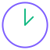
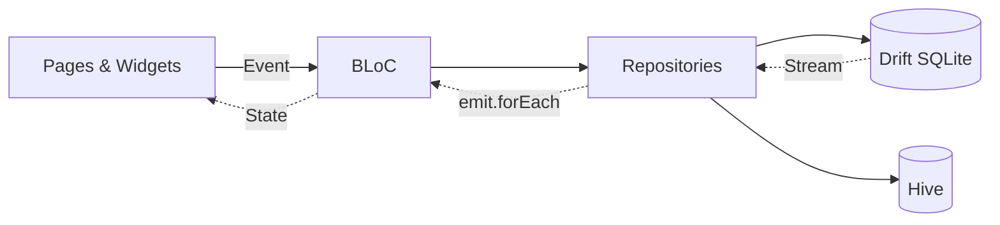

<div align="center">

#  LevelUp Money Life

**แอปบริหารเงินส่วนตัว + Gamification RPG — บันทึกรายการจบใน 3 วินาที**


</div>

##  ฟีเจอร์เด่น

| | ฟีเจอร์ | สรุป |
| :---: | :--- | :--- |
|  | **QuickAdd + SmartNumpad** | ประเภท / หมวด / ยอด / โน้ต ใน Bottom Sheet เดียว คำนวณ `+` `-` ได้ |
|  | **QuickTemplate** | แตะครั้งเดียวบันทึกรายการโปรด + แนะนำ Top 5 ที่ใช้บ่อย |
|  | **Reactive Sync** | Drift Stream อัปเดตทุกหน้าแบบ Real-time ไม่ต้อง Reload |
|  | **Gamification RPG** | Level, Rank, Daily Quest, Streak และ `+XP` Toast |
|  | **Budget 50/30/20** | แบ่ง Needs / Wants / Savings พร้อมเตือน Overbudget และกราฟ Cash Flow |
|  | **Settings** | ธีม System/Light/Dark, ภาษา TH/EN, Export/Import JSON แบบ Offline |

##  สถาปัตยกรรม

Clean Architecture + Feature-Driven



##  Tech Stack

| หมวด | ไลบรารี |
| :--- | :--- |
| State | `flutter_bloc`, `equatable` |
| DI | `get_it` |
| Routing | `auto_route` |
| Database | `drift` (SQLite), `hive` (Key-Value) |
| UI | `flutter_tailwind_colors`, `toastification` |
| i18n | `flutter_localizations`, `intl` (`.arb`) |

##  โครงสร้างโปรเจกต์

```text
lib/
├── config/        # Environment & App Config
├── domain/        # datasource, models, repositories, services
├── feature/       # dashboard, budget, gamification, transaction, home
├── i18n/          # TH / EN
├── router/        # AutoRoute
├── shared/        # bloc, components, tokens (Design System)
├── locator.dart   # Dependency Injection
└── main.dart
```

##  เริ่มต้นใช้งาน

ต้องมี: [FVM](https://fvm.app/) หรือ Flutter `3.38.9`, Android Studio / Xcode

```bash
git clone https://github.com/Theeraphat-S/levelup-money-life-mobile.git
cd levelup-money-life-mobile
fvm use 3.38.9
fvm flutter pub get
dart run build_runner build --delete-conflicting-outputs
fvm flutter run --flavor dev -t lib/main.dart --dart-define=flavor=dev
```

##  Code Generation

| งาน | คำสั่ง |
| :--- | :--- |
| Drift / AutoRoute | `dart run build_runner build --delete-conflicting-outputs` (หรือ `watch`) |
| i18n | `./generate_i18n.sh` — รวม `.arb` ใน `lib/i18n/locals/<page>/` |
| Feature ใหม่ | `./create_feature.sh <name> [--appbar] [--bottombar]` |

##  Testing

```bash
flutter analyze
flutter test
```

ครอบคลุม Drift Streams, GamificationEngine, SmartNumpad Parser, QuickTemplate และ Layout 320–360dp (ไม่มี Overflow)

##  Build & Deploy

Flavors: `local`, `dev`, `prod`

| แพลตฟอร์ม | Dev | Prod |
| :--- | :--- | :--- |
| Android | `./build_apk_dev.sh` | `./build_apk_prod.sh` |
| iOS | `./build_ipa_dev.sh` | `fvm flutter build ipa --release` |
| Windows | `build_windows_dev.bat` | `build_windows_prod.bat` |

iOS: `cd ios && pod install` แล้วตั้ง Signing ใน `ios/Runner.xcworkspace`

##  Coding Standards

- ศัพท์ Domain ยึดตาม [`CONTEXT.md`](CONTEXT.md)
- State / Event ใช้ `Equatable` ทุกตัว, รับ Stream ผ่าน `emit.forEach`
- DI ใน [`locator.dart`](lib/locator.dart): Repository → `registerLazySingleton`, BLoC → `registerFactory`
- ตั้งชื่อ: ไฟล์ `snake_case`, คลาส `UpperCamelCase`, ตัวแปร `lowerCamelCase`

##  License

[MIT](LICENSE) © [Theeraphat-S](https://github.com/Theeraphat-S) · Icons by [Lordicon](https://lordicon.com/)
